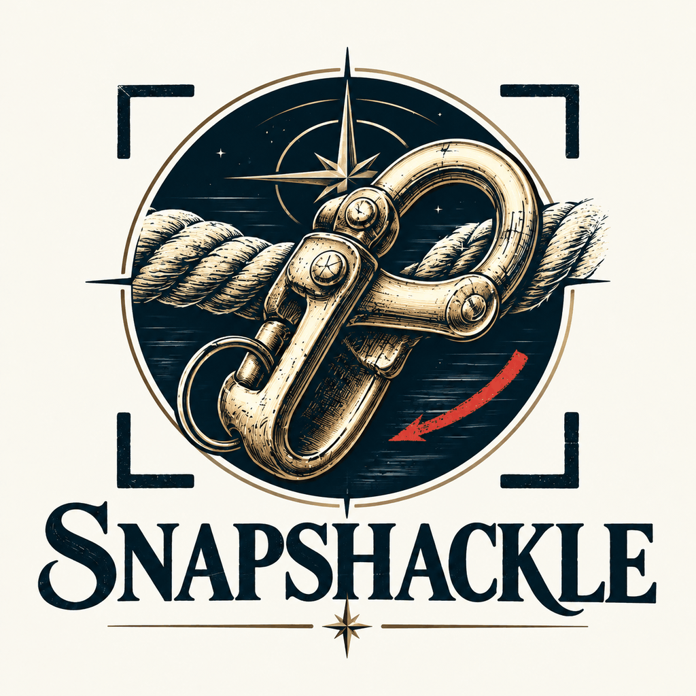
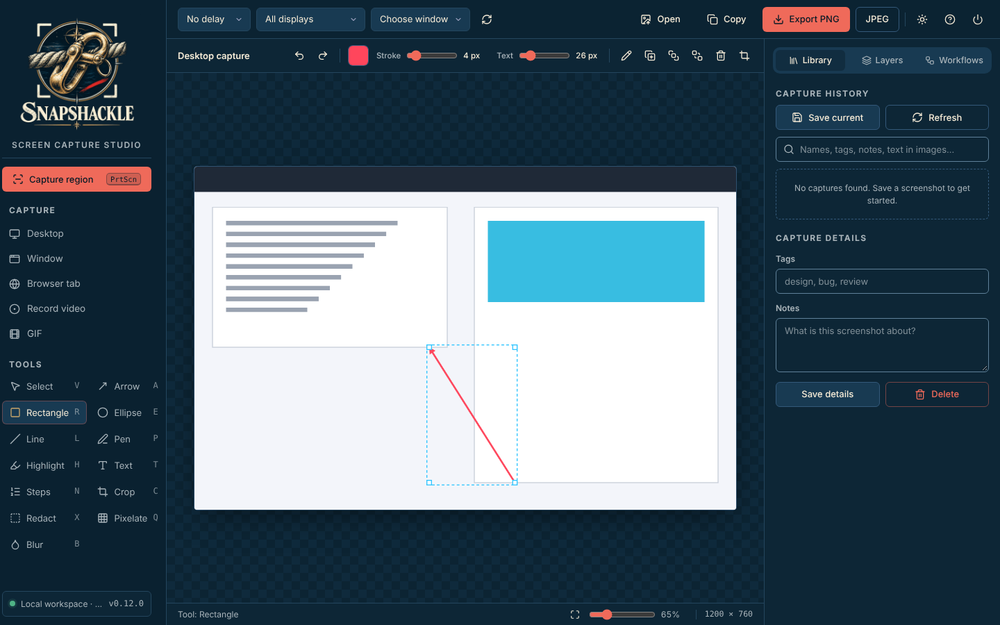
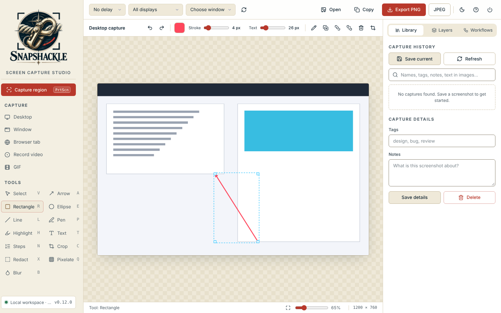

<p align="center">
  <picture>
    <source media="(prefers-color-scheme: dark)" srcset="assets/brand/emblem-dark.png">
    
  </picture>
</p>

# SnapShackle

A **local-first Windows screenshot and annotation studio** using native Windows capture, a built-in PowerShell HTTP host, and an offline browser UI. Designed to run without Node, Python, npm, CDN, a package installer, or administrator rights on an authorized Windows workstation.

See [the roadmap](https://claude.ai/artifact/K9as42yNHQ2fxTx2j5A7Ag) for where it is going.

## The name

A **snap shackle** is a quick-release sailing shackle: it clips on in a moment and lets go just as fast. SnapShackle does the same with your screen: snap it, then shackle your marks to it. Formerly **CutterMk**, **Lasso** and **SnipHero**.

**Status:** An expanding prototype with a tested browser editor; **not production-hardened or feature-complete**. A genuine Windows desktop run and security review are required before use with sensitive work data.

| Night watch (dark) | Chart room (light) |
| --- | --- |
|  |  |

The screenshots show an invented demo window, not a real capture. Retake them with `node docs/screenshots/capture-studio.js`.

## Run on Windows (managed-workstation-friendly launch pattern)

1. Extract **the entire archive**, retaining `assets/`, `modules/`, and `tests/`.
2. Double-click **`Launch-SnapShackle.bat`** to launch the GUI. This is the **only batch launcher**; `Start-SnapShackle.ps1` is the direct PowerShell/terminal entry point.
3. SnapShackle first tries **127.0.0.1:8765**. If Gangplank, Halyard, Lazarette, or another application already uses it, SnapShackle **binds an available loopback port** and opens its browser at the **actual chosen address**. Other servers are never stopped, modified, or taken over. Use the URL printed in the console if the browser does not launch automatically.
4. **Closing the studio tab stops SnapShackle**: the local server, the tray icon and the global hotkeys, about 5 seconds after the last studio tab closes (20 seconds if the browser just disappears). A reload does not stop it, and with two studio tabs open, closing one keeps it running. **End session** (top right of the studio), **Exit** in the tray menu, `Stop-SnapShackle.ps1` or Ctrl+C in the console also stop it.

### Session lifecycle

| You want | Do this |
| --- | --- |
| SnapShackle only while the studio is open (default) | `Launch-SnapShackle.bat`. Closing the tab stops everything, so nothing hides in the background holding the port or the hotkeys. |
| Hotkeys and the tray icon after the studio closes | `Launch-SnapShackle.bat --stay` (or `-Stay`), or tick **Workflows → Settings → Keep hotkeys in the tray after this tab closes**. The tray icon stays visible; right-click it and choose **Exit** to stop SnapShackle. Click it to reopen the studio. |
| Never auto-stop (scripts, testing) | Set `SNAPSHACKLE_AUTO_STOP=0` before starting (the older `CUTTERMK_AUTO_STOP=0` still works). |
| Stop every running SnapShackle from a shell | `powershell -NoProfile -ExecutionPolicy Bypass -File Stop-SnapShackle.ps1` |

- **Hidden tabs.** A studio tab in the background keeps SnapShackle running (it reports itself hidden and gets 75 seconds between heartbeats, because browsers slow timers in background tabs). A tab the browser puts to sleep or discards (Edge "sleeping tabs") counts as closed; use `--stay` or the tray preference if you rely on hotkeys with the studio long in the background.
- **One instance.** If SnapShackle is already running, the launcher says where and asks *Stop it and start fresh?*. `--replace` (or `-Replace`) answers yes without asking. If that copy is still running after the stop request, the launcher warns and does not start a second one.
- **A restarted server.** The studio window title includes the port and a start id. After the server starts again, an old tab shows that the session stopped, with a **Reload** button, instead of failing in silence. The tray, a tray click, and a capture notification focus only the current session's window, and open a fresh tab when that window is not there. The browser opens after the local health check answers. If Explorer restarts, the tray icon is added again.
- **Never mid-save.** Auto-stop waits while a hotkey capture is still being saved, copied and indexed, then stops on the next check.
- **Runtime files.** Each running SnapShackle writes `%LOCALAPPDATA%\SnapShackle\logs\snapshackle-server-<pid>.json` (pid, port, URL, start time; never the session token) next to its captures and settings, and deletes it when it stops. `Stop-SnapShackle.ps1` and the launcher read these (and the `%LOCALAPPDATA%\CutterMk\logs\cuttermk-server-<pid>.json` files of a CutterMk build), remove stale ones, and also find a SnapShackle or CutterMk started without one. A running SnapShackle is asked to stop first, so it removes its tray icon and releases its hotkeys itself; only one that does not answer is force-stopped.

### Why the batch launcher exists

`Launch-SnapShackle.bat` uses **Windows PowerShell 5.1** with `-STA -NoProfile -NoLogo -ExecutionPolicy Bypass`. The flag is explicitly visible in the launcher and **only applies to the new PowerShell process**. It does **not** elevate privileges, change machine/user execution-policy configuration, override domain Group Policy, or defeat AppLocker, WDAC, endpoint protection, or enterprise restrictions. Only launch scripts in an environment in which you are authorized to do so. If organizational controls block it, contact IT for an approved route rather than defeating those controls.

SnapShackle's HTTP server now uses a **raw `TcpListener` bound exclusively to 127.0.0.1** instead of `HttpListener`. It therefore does not depend on Windows HTTP.sys URL reservations / URLACL admin setup. The default port is a preference, not a hard requirement. The app tries 100 successive ports and finally allows Windows to allocate an ephemeral loopback port if those are unavailable. Port binding is atomic; there is no separate "check if available" race. The UI uses relative API URLs, so screenshots, OCR, and the library automatically target the chosen port.

### Options and diagnostics

```bat
Launch-SnapShackle.bat -NoBrowser
Launch-SnapShackle.bat -Port 9000
Launch-SnapShackle.bat -Diagnostics
Launch-SnapShackle.bat --stay
Launch-SnapShackle.bat --replace
```

`-NoBrowser` keeps the host running and prints its URL (it then stops once a studio tab that connected has closed; add `--stay` to keep it). `-Port` changes the **preferred** port but still safely falls back on collision. `-Diagnostics` prints the PowerShell/process policy and tests a loopback socket bind; it then exits without starting the long-running host. For detailed network/startup validation on a Windows PC, run `tests/windows_port_smoke.ps1` in an **authorized** PowerShell session. It temporarily holds an unused local port, starts SnapShackle separately on that preferred port, confirms fallback and startup, and closes only the test-owned processes. It never touches other apps.

Captures live under `%LOCALAPPDATA%\SnapShackle\Captures`. On first start, when that folder does not exist yet, SnapShackle **copies** the captures and settings from `%LOCALAPPDATA%\CutterMk` into it and leaves the CutterMk folder exactly as it was. Anything still in `%LOCALAPPDATA%\Lasso` or `%LOCALAPPDATA%\SnipHero` is then **moved** in, as CutterMk did (never deleted or overwritten; a name that already exists stays in the old folder). Old `CutterMk-*.png`, `Lasso-*.png` and `SnipHero-*.png` names keep working, and an old default file-name prefix becomes `SnapShackle`. Preferences are stored in `%LOCALAPPDATA%\SnapShackle\settings.json`. Screenshot bytes, recorded audio and OCR data are not transmitted off the computer by SnapShackle. This single-user local service is not an authentication boundary against programs already running under your own user identity; do not expose it on network interfaces.

## Renamed to SnapShackle

- Launch with **`Launch-SnapShackle.bat`** (was `CutterMk.bat`); `Start-SnapShackle.ps1` and `Stop-SnapShackle.ps1` replace `Start-CutterMk.ps1` and `Stop-CutterMk.ps1`. `CutterMk.bat` is kept as a one-line stub that runs `Launch-SnapShackle.bat`, so old shortcuts keep working. If you unpack the new zip over a CutterMk folder, delete the leftover `Start-CutterMk.ps1` and `Stop-CutterMk.ps1`: they belong to the old build and fail against the new `modules/`.
- Data lives in `%LOCALAPPDATA%\SnapShackle`. On first start the CutterMk folder is copied there once and left untouched, so going back to a CutterMk build still finds its own captures (captures made in SnapShackle afterwards stay in SnapShackle).
- Studio preferences kept in browser storage move to `snapshackle-settings` and `snapshackle-theme`; the `cuttermk-*` keys are copied forward and left in place.
- A CutterMk (or Lasso) instance that is still running is treated as already running, so the single-instance rule holds across the upgrade (`Stop-SnapShackle.ps1` stops it too).
- Environment variables are now `SNAPSHACKLE_AUTO_STOP` and `SNAPSHACKLE_CHROMIUM`; `CUTTERMK_AUTO_STOP` and `CUTTERMK_CHROMIUM` are still read when the new ones are not set.

## Renamed to CutterMk (v0.12)

- Launch with **`CutterMk.bat`** (was `Lasso.bat`); `Start-CutterMk.ps1` and `Stop-CutterMk.ps1` replace the Lasso scripts.
- Data lives in `%LOCALAPPDATA%\CutterMk`. Captures and settings from Lasso and SnipHero are moved there on first start; nothing is copied, deleted or overwritten.
- A Lasso instance that is still running is treated as already running, so the single-instance rule holds across the upgrade.
- Environment variables are now `CUTTERMK_AUTO_STOP` and `CUTTERMK_CHROMIUM`.

## One look with ARC, now Lazarette (v0.11)

- The studio now uses **Lazarette's design system**: the same colour tokens, Inter and Cascadia type, radius and shadow scale, button styles, sidebar and top-bar layout, and **Lucide icons** (1.54.0, the version Lazarette uses, bundled offline in `assets/icons.js`).
- **Light and dark themes** like Lazarette: dark by default, a sun/moon button in the top bar, and **Workflows → Settings → Theme** offers Dark, Light or Match Windows. The choice is saved by the host.
- **Single-key tool shortcuts** shown beside each tool: `V` select, `A` arrow, `R` rectangle, `E` ellipse, `L` line, `P` pen, `H` highlight, `T` text, `N` steps, `C` crop, `X` redact, `Q` pixelate, `B` blur. They are ignored while you type in a field.
- The native selection overlay and the tray icon use the same violet and sky accents.

## Smart redaction and searchable library (v0.10)

- **Find sensitive info** (Workflows tab) reads the image with OCR and lists emails, SSNs, card numbers (Luhn-checked), DoD IDs (10 digits), US phone numbers and IPv4 addresses. Untick anything you want to keep, then **Redact checked** covers the rest with solid boxes in one undo step. **Redact every instance of** covers a word or phrase wherever OCR finds it. OCR can miss small or stylised text, so check the image before you share it.
- **Search by the text in your screenshots.** Captures saved to the library (and hotkey captures) are OCR-indexed in their `.meta.json` sidecar, and library search matches that text as well as names, tags and notes. Results found through the image text say so. Editing tags or notes keeps the index.
- **Drag-to-crop** (the Crop tool) trims the image and moves every annotation with it, so arrows, text and redactions stay editable. Undo restores the full image. The old Crop button (exact pixel values) works the same way; neither flattens annotations any more.
- **Preferences are stored by the host** in `%LOCALAPPDATA%\SnapShackle\settings.json`. The browser keys its storage by origin, and the origin includes the port, so a port fallback used to start with empty preferences.

## Capturing without the studio in the way (v0.9)

- **Global hotkeys** work from any app, so the studio never appears in your captures. SnapShackle tries each preferred chord and falls back if another app (or Windows' "Print Screen opens Snipping Tool" setting) already owns it:

  | Capture | Preferred | Fallback |
  | --- | --- | --- |
  | Region (or click a window) | `PrtScn` | `Ctrl+Alt+S` |
  | Active window | `Alt+PrtScn` | `Ctrl+Alt+W` |
  | Screen under the cursor | `Shift+PrtScn` | `Ctrl+Alt+F` |

  The console, the tray tooltip menu and **Workflows → Diagnostics** show which chords are active. A hotkey capture is copied to the clipboard (bitmap plus PNG), saved to the library, and opened in the studio if it is open. Click the notification or the tray icon to open the studio.
- **Tray icon** with Capture region, Capture screen, Open studio and Exit. Start with `-NoTray` to skip hotkeys and the tray. By default the tray icon and hotkeys go away with the studio tab; see [Session lifecycle](#session-lifecycle) to keep them.
- **Selection overlay:** hovering highlights the window under the cursor and a click takes it; dragging draws a free region; `Shift` keeps it square; `Esc` or right-click cancels. A loupe shows magnified pixels, screen coordinates and the colour under the cursor. The overlay takes keyboard focus as it opens.
- **Window capture uses `PrintWindow`** (`PW_RENDERFULLCONTENT`), so a window's own content is captured even where other windows, including the studio, cover it. Apps that answer with a blank image fall back to screen pixels; the status bar says which method was used. Window bounds come from DWM, so the invisible 7 px resize borders are no longer included, and windows on other virtual desktops are hidden from the list.
- **Per-monitor DPI v2**, so selections line up on mixed-DPI monitors.
- **Delay:** 3, 5 or 10 seconds before a studio-button capture, to open menus or switch windows.

## Screenshot latency improvements (v0.7)

- **Single desktop snapshot for region capture:** region selection now crops the **already-captured original bitmap**. The previous build called `CopyFromScreen` *again* after selection, adding latency and risking capture of the overlay or newer screen state. Crop uses lossless GDI+ `Bitmap.Clone` and preserves native resolution.
- **Direct browser image loading:** screenshots travel as PNG `Blob` objects, without converting every capture into a large Base64 data URL. The editor retains compressed blob URLs for undo/redo; only explicit editable-project exports embed an image as a portable data URL.
- **Accelerated canvas:** the editor no longer opts into the CPU-oriented `willReadFrequently` canvas mode; layer buttons are no longer rebuilt on every pointer move.
- **Nonblocking automatic save:** the new screenshot is shown before library disk I/O. When the source is a PNG, autosave writes its original bytes rather than re-encoding an already-clean canvas.
- **Bounded, on-demand thumbnails:** the library now loads small 216×136 JPEG thumbnails with a bounded in-memory server cache. Browser thumbnail requests use `IntersectionObserver` and a maximum of two concurrent fetches, keeping image browsing from competing with capture traffic. The original saved PNGs are unchanged, and cached thumbnails are never persisted to disk.
- **Less server copying:** HTTP request headers use a buffered reader. PNG responses are written directly rather than copying large byte arrays through a separate response `MemoryStream`.

After a capture, the bottom status bar and **Workflows → Diagnostics** show a per-stage timing breakdown. `native` measures Windows screen acquisition, `PNG` measures encoding, `request/transfer` includes the server processing and transmission, and `browser display` measures image decoding and first editor render. For region selection, total request time necessarily includes **the time spent dragging the selection**; that user interaction is shown separately.

**No precise speedup percentage is claimed:** only browser integration tests ran in the build environment. GDI capture and socket performance must be measured on a Windows managed workstation. Run `tests/windows_capture_perf.ps1 -DesktopCapture` in an authorized PowerShell 5.1 STA session to benchmark the native stages.

## Implemented functionality

| Area | What works | Caveats |
|---|---|---|
| Desktop screenshot | Entire desktop, selected monitor, selected visible window, native drag-to-select region | Standard `CopyFromScreen`; not minimized/occluded windows or DRM-protected content |
| Browser screenshot | Browser screen/window/tab capture after user permission | Browser support and permission required |
| Editor | Arrows, boxes, ellipses, lines, pen, highlighter, text, numbered steps, opaque redaction, pixelate, blur; layer reordering; drag and corner resizing; object duplication/deletion | Some object transforms remain simplified; complex multi-object grouping not available |
| History/project | Undo/redo, editable JSON project, crop, image import/paste/drag-drop, PNG/JPEG, clipboard, zoom | Save editable JSON **only for trusted local use**, since it includes the original pixels |
| Library | Save PNGs locally, browse thumbnails, search names/tags/notes, edit tags/notes, delete | No cloud sync or SQLite, limited to newest 250 search hits |
| Screen video | WebM, or MP4 (H.264) where Edge or Chrome can write it, via browser MediaRecorder; choose under Workflows, Settings, Video file format. Optional sound is off until chosen: system or tab audio, a microphone, or both mixed into one Opus track | MP4 depends on the browser's own encoder: if it cannot write MP4 the recording is WebM and the status bar says so. No transcoding, trimming or timeline editing. System audio needs Share audio ticked in the Edge or Chrome prompt. A declined microphone or missing Share audio records video only. GIF stays silent. Sound stays on this computer |
| Animated GIF | Offline dependency-free encoder; 640×480 max, 100 frames | 3-3-2 limited palette, unoptimized file sizes; tested for valid GIF decoding |
| Long screenshots | Automatic overlap-aware stitching of multiple screenshots; optional browser shared-screen sampling while **you scroll the target** | Not an autonomous scroll driver for arbitrary Windows apps; sticky headers/transitions can reduce stitching quality |
| OCR | Attempts Windows.Media.Ocr on PowerShell 5.1 where WinRT is available; tries browser TextDetector otherwise | Windows integration is tested on Windows 11 with synthetic images (`tests/windows_ocr_test.ps1`: text, word boxes, oversize images, blank image); not yet checked on a managed workstation or with non-English language packs. Browser API often missing |
| UI | Offline red/black workspace, Library/Layers/Workflows tabs, editable layers, status diagnostics with per-stage capture timings, common focused-tab keyboard shortcuts | Not yet a fully audited accessible enterprise desktop application |

### Redaction safety

Pixelation and blur are **visual effects, not secure sanitization**. Opaque redaction hides annotated regions in flattened exported images, but editable `.snapshackle.json` projects retain the unredacted original. Imported original files and other copies are unaffected. Inspect flattened exports and follow your organization's data handling policy.

### Known gaps

- No universal autonomous scrolling through arbitrary external applications.
- OCR is validated on Windows 11 only with English synthetic text; run `tests/windows_ocr_test.ps1 -RequireOcr` on each managed workstation before relying on it.
- No signed installer, MSI, policy-managed settings, centralized telemetry, update service, multi-user permissions, or full enterprise accessibility certification.
- Not supported: panoramic capture, camera/PIP recording, timeline video editing, multi-track audio editing, enterprise managed deployment, or share-destination integrations.

## Testing and development

- `pwsh dev/csharp_check.ps1 -ReferenceDir <v4.8 reference assemblies>` compiles every inline C# block as C# 5 against .NET Framework 4.8 (what Windows PowerShell 5.1 uses), so native code can be checked without Windows. Reference assemblies: the `v4.8` folder of [mono/reference-assemblies](https://github.com/mono/reference-assemblies).
- `python tests/effects_test.py` checks that blur stays aligned with what it covers.
- `powershell -NoProfile -File tests/host_tests.ps1` tests the HTTP transport (Host checks, port fallback, rejected requests), the CutterMk, Lasso and SnipHero migrations and the lifecycle rules on a simulated clock (heartbeat timeout, leaving grace, reload, several tabs, busy capture, sleep/wake, runtime files, stopping an instance without its PID). It also parses every `.ps1` file. Runs on Windows PowerShell 5.1 and PowerShell 7.
- CI runs these on the self-hosted Windows runner (`.github/workflows/tests.yml`). Pushing a `v*` tag that matches `VERSION` builds `SnapShackle-<version>.zip` with runtime files only (`release.yml`).

Only development/testing requires Python, Pillow, Chromium/Playwright or Node. **Runtime has no dependency on these tools.**

- `node --check assets/editor.js` (also check `studio.js`, `gif.js`, and `stitch.js`)
- `python tests/static_check.py` checks source structure/routes and UI wiring.
- `python tests/launcher_static_check.py` verifies launcher settings, TCP adapter, and dynamic port propagation.
- `tests/windows_port_smoke.ps1` verifies localhost collision behavior on Windows 5.1 (requires user-authorized runtime).
- `powershell -NoProfile -STA -File tests/windows_ocr_test.ps1` runs the Windows OCR bridge on text drawn in memory (no screen capture). It skips with a message where OCR is missing; add `-RequireOcr` to fail instead.
- `tests/windows_capture_perf.ps1 -DesktopCapture` verifies pixel-perfect source-bitmap crops and prints native capture and PNG encoding timings on Windows.
- `python tests/browser_smoke.py` runs actual Chromium editor interactions against a simulated local capture API, including a lost session (invalid session, failed heartbeat, or failed poll) and the Reload button.
- `python tests/stitch_test.py` tests seam detection with overlapping synthetic screenshots.
- `node tests/gif_test.js` followed by `python tests/verify_gif.py` validates animated GIF decoding in Pillow.
- `node tests/audio_test.js` checks the record-sound choices, the video-only fallback when Share audio or the microphone is unavailable, and the WebM/MP4 choice with its fallback.
- `python tests/mp4_record_test.py` records a synthetic canvas in installed Edge (then Chrome) and checks the bytes are a real MP4 (`ftyp` box) and a real WebM. It skips with a message if no installed browser can write MP4; Playwright's bundled Chromium cannot.
- `python tests/storage_migration_test.py` checks that browser preferences saved under the `cuttermk-*` keys are copied forward to `snapshackle-*` once, with the old keys kept.

Automated Chromium tests **do not** verify the native Windows capture integration or enterprise managed-workstation compatibility. Test on a machine with the correct Windows desktop, PowerShell version, browser, and organization-approved policies.

## Project structure

```text
Launch-SnapShackle.bat     Windows GUI launcher (process-scoped PowerShell flags)
CutterMk.bat               Forwarding stub for shortcuts made before the rename
Start-SnapShackle.ps1      Local HTTP host, capture API and library
Stop-SnapShackle.ps1       Stops every running SnapShackle (server, tray icon, hotkeys) without PIDs
VERSION                    Single source of the version number
modules/LocalHttp.ps1      Loopback TCP / bounded HTTP adapter and dynamic port binding
modules/Native.ps1         Windows Forms region overlay and Win32 enumeration
modules/Ocr.ps1            Optional Windows 10+ OCR bridge
modules/Migration.ps1      One-time copy of CutterMk data (and move of Lasso / SnipHero data) into SnapShackle
modules/Library.ps1        Capture naming and saving, shared by the host and the tray
modules/Tray.ps1           Global hotkeys and tray icon on their own STA thread
modules/Lifecycle.ps1      Tab-owns-the-server presence rule, runtime files, finding/stopping instances
index.html                 Studio layout
assets/styles.css          Standalone responsive theme
assets/editor.js           Editable non-destructive object engine
assets/studio.js           App/controller, recording, library, workflows
assets/audio.js            Optional local WebM sound (system audio, microphone, or both)
assets/gif.js              Offline GIF89a encoder
assets/stitch.js           Overlap-aware long screenshot stitching
assets/brand/              README emblems (not loaded by the app, not in release zips)
tests/                     Development-time host, browser and static tests
dev/                       Personal-PC development launcher (not in release zips)
TechStack.md               Stack rules and SnapShackle's choices and exceptions
```

The runtime contains **original source code**; ShareX, Flameshot, Excalidraw, and Fabric.js were only feature/design references and are not bundled dependencies.