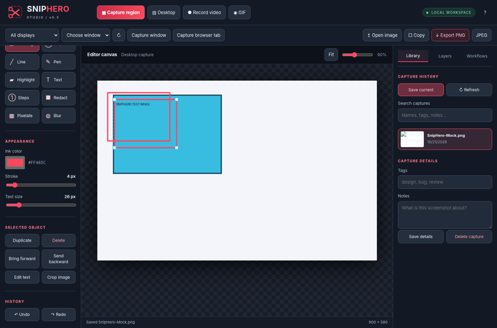

# Lasso Studio

A **local-first Windows screenshot and annotation studio** using native Windows capture, a built-in PowerShell HTTP host, and an offline browser UI. Designed to run without Node, Python, npm, CDN, a package installer, or administrator rights on an authorized Windows workstation.

Lasso was previously called **SnipHero**. See [the roadmap](https://claude.ai/artifact/K9as42yNHQ2fxTx2j5A7Ag) for where it is going.

**Status:** An expanding prototype with a tested browser editor; **not a production-hardened or feature-complete Snagit/ShareX replacement**. A genuine Windows desktop run and security review are required before use with sensitive work data.



## Run on Windows (Nautilus-friendly launch pattern)

1. Extract **the entire archive**, retaining `assets/`, `modules/`, and `tests/`.
2. Double-click **`Lasso.bat`** to launch the GUI. This is the **only batch launcher**; `Start-Lasso.ps1` is the direct PowerShell/terminal entry point.
3. Lasso first tries **127.0.0.1:8765**. If Keystone, Cascade, ARC, or another application already uses it, Lasso **binds an available loopback port** and opens its browser at the **actual chosen address**. Other servers are never stopped, modified, or taken over. Use the URL printed in the console if the browser does not launch automatically.
4. Keep the terminal open while using Lasso. Press Ctrl+C to stop Lasso alone.

### Why the batch launcher exists

`Lasso.bat` uses **Windows PowerShell 5.1** with `-STA -NoProfile -NoLogo -ExecutionPolicy Bypass`. The flag is explicitly visible in the launcher and **only applies to the new PowerShell process**. It does **not** elevate privileges, change machine/user execution-policy configuration, override domain Group Policy, or defeat AppLocker, WDAC, endpoint protection, or enterprise restrictions. Only launch scripts in an environment in which you are authorized to do so. If organizational controls block it, contact IT for an approved route rather than defeating those controls.

Lasso's HTTP server now uses a **raw `TcpListener` bound exclusively to 127.0.0.1** instead of `HttpListener`. It therefore does not depend on Windows HTTP.sys URL reservations / URLACL admin setup. The default port is a preference, not a hard requirement. The app tries 100 successive ports and finally allows Windows to allocate an ephemeral loopback port if those are unavailable. Port binding is atomic; there is no separate "check if available" race. The UI uses relative API URLs, so screenshots, OCR, and the library automatically target the chosen port.

### Options and diagnostics

```bat
Lasso.bat -NoBrowser
Lasso.bat -Port 9000
Lasso.bat -Diagnostics
```

`-NoBrowser` keeps the host running and prints its URL. `-Port` changes the **preferred** port but still safely falls back on collision. `-Diagnostics` prints the PowerShell/process policy and tests a loopback socket bind; it then exits without starting the long-running host. For detailed network/startup validation on a Windows PC, run `tests/windows_port_smoke.ps1` in an **authorized** PowerShell session. It temporarily holds an unused local port, starts Lasso separately on that preferred port, confirms fallback and startup, and closes only the test-owned processes. It never touches other apps.

Captures live under `%LOCALAPPDATA%\Lasso\Captures`. On first start, Lasso **moves** any SnipHero captures from `%LOCALAPPDATA%\SnipHero\Captures` into it (files are never copied, deleted or overwritten; a name that already exists stays in the old folder). Old `SnipHero-*.png` names and `.sniphero.json` projects keep working. Browser settings are stored locally (`localStorage`). Screenshot bytes and OCR data are not transmitted off the computer by Lasso. This single-user local service is not an authentication boundary against programs already running under your own user identity; do not expose it on network interfaces.

## Smart redaction and searchable library (v0.10)

- **Find sensitive info** (Workflows tab) reads the image with OCR and lists emails, SSNs, card numbers (Luhn-checked), DoD IDs (10 digits), US phone numbers and IPv4 addresses. Untick anything you want to keep, then **Redact checked** covers the rest with solid boxes in one undo step. **Redact every instance of** covers a word or phrase wherever OCR finds it. OCR can miss small or stylised text, so check the image before you share it.
- **Search by the text in your screenshots.** Captures saved to the library (and hotkey captures) are OCR-indexed in their `.meta.json` sidecar, and library search matches that text as well as names, tags and notes. Results found through the image text say so. Editing tags or notes keeps the index.
- **Drag-to-crop** (the Crop tool) trims the image and moves every annotation with it, so arrows, text and redactions stay editable. Undo restores the full image. The old Crop button (exact pixel values) works the same way; neither flattens annotations any more.
- **Preferences are stored by the host** in `%LOCALAPPDATA%\Lasso\settings.json`. The browser keys its storage by origin, and the origin includes the port, so a port fallback used to start with empty preferences.

## Capturing without the studio in the way (v0.9)

- **Global hotkeys** work from any app, so the studio never appears in your captures. Lasso tries each preferred chord and falls back if another app (or Windows' "Print Screen opens Snipping Tool" setting) already owns it:

  | Capture | Preferred | Fallback |
  | --- | --- | --- |
  | Region (or click a window) | `PrtScn` | `Ctrl+Alt+S` |
  | Active window | `Alt+PrtScn` | `Ctrl+Alt+W` |
  | Screen under the cursor | `Shift+PrtScn` | `Ctrl+Alt+F` |

  The console, the tray tooltip menu and **Workflows → Diagnostics** show which chords are active. A hotkey capture is copied to the clipboard (bitmap plus PNG), saved to the library, and opened in the studio if it is open. Click the notification or the tray icon to open the studio.
- **Tray icon** with Capture region, Capture screen, Open studio and Quit Lasso. Start with `-NoTray` to skip hotkeys and the tray.
- **Selection overlay:** hovering highlights the window under the cursor and a click takes it; dragging draws a free region; `Shift` keeps it square; `Esc` or right-click cancels. A loupe shows magnified pixels, screen coordinates and the colour under the cursor. The overlay takes keyboard focus as it opens.
- **Window capture uses `PrintWindow`** (`PW_RENDERFULLCONTENT`), so a window's own content is captured even where other windows, including the studio, cover it. Apps that answer with a blank image fall back to screen pixels; the status bar says which method was used. Window bounds come from DWM, so the invisible 7 px resize borders are no longer included, and windows on other virtual desktops are hidden from the list.
- **Per-monitor DPI v2**, so selections line up on mixed-DPI monitors.
- **Delay:** 3, 5 or 10 seconds before a studio-button capture, to open menus or switch windows.

## Screenshot latency improvements (v0.7)

- **Single desktop snapshot for region capture:** region selection now crops the **already-captured original bitmap**. The previous build called `CopyFromScreen` *again* after selection, adding latency and risking capture of the overlay or newer screen state. Crop uses lossless GDI+ `Bitmap.Clone` and preserves native resolution.
- **Direct browser image loading:** screenshots travel as PNG `Blob` objects, without converting every capture into a large Base64 data URL. The editor retains compressed blob URLs for undo/redo; only explicit editable-project exports embed an image as a portable data URL.
- **Accelerated canvas:** the editor no longer opts into the CPU-oriented `willReadFrequently` canvas mode; layer buttons are no longer rebuilt on every pointer move.
- **Nonblocking automatic save:** the new screenshot is shown before library disk I/O. When the source is a PNG, autosave writes its original bytes rather than re-encoding an already-clean canvas.
- **Bounded, on-demand thumbnails:** the library now loads small 216×136 JPEG thumbnails with a bounded in-memory server cache. Browser thumbnail requests use `IntersectionObserver` and a maximum of two concurrent fetches, keeping image browsing from competing with capture traffic. The original saved PNGs are unchanged, and cached thumbnails are never persisted to disk.
- **Less server copying:** HTTP request headers use a buffered reader. PNG responses are written directly rather than copying large byte arrays through a separate response `MemoryStream`.

After a capture, the bottom status bar and **Workflows → Diagnostics** show a per-stage timing breakdown. `native` measures Windows screen acquisition, `PNG` measures encoding, `request/transfer` includes the server processing and transmission, and `browser display` measures image decoding and first editor render. For region selection, total request time necessarily includes **the time spent dragging the selection**; that user interaction is shown separately.

**No precise speedup percentage is claimed:** only browser integration tests ran in the build environment. GDI capture and socket performance must be measured on Windows / Nautilus. Run `tests/windows_capture_perf.ps1 -DesktopCapture` in an authorized PowerShell 5.1 STA session to benchmark the native stages.

## Implemented functionality

| Area | What works | Caveats |
|---|---|---|
| Desktop screenshot | Entire desktop, selected monitor, selected visible window, native drag-to-select region | Standard `CopyFromScreen`; not minimized/occluded windows or DRM-protected content |
| Browser screenshot | Browser screen/window/tab capture after user permission | Browser support and permission required |
| Editor | Arrows, boxes, ellipses, lines, pen, highlighter, text, numbered steps, opaque redaction, pixelate, blur; layer reordering; drag and corner resizing; object duplication/deletion | Some object transforms remain simplified; complex multi-object grouping not available |
| History/project | Undo/redo, editable JSON project, crop, image import/paste/drag-drop, PNG/JPEG, clipboard, zoom | Save editable JSON **only for trusted local use**, since it includes the original pixels |
| Library | Save PNGs locally, browse thumbnails, search names/tags/notes, edit tags/notes, delete | No cloud sync or SQLite, limited to newest 250 search hits |
| Screen video | WebM via browser MediaRecorder | No system audio/MP4 without additional codecs; recording window/tab requires browser permission |
| Animated GIF | Offline dependency-free encoder; 640×480 max, 100 frames | 3-3-2 limited palette, unoptimized file sizes; tested for valid GIF decoding |
| Long screenshots | Automatic overlap-aware stitching of multiple screenshots; optional browser shared-screen sampling while **you scroll the target** | Not an autonomous scroll driver for arbitrary Windows apps; sticky headers/transitions can reduce stitching quality |
| OCR | Attempts Windows.Media.Ocr on PowerShell 5.1 where WinRT is available; tries browser TextDetector otherwise | Windows integration is **experimental and untested on a real Windows system**; browser API often missing |
| UI | Offline red/black workspace, Library/Layers/Workflows tabs, editable layers, status diagnostics with per-stage capture timings, common focused-tab keyboard shortcuts | Not yet a fully audited accessible enterprise desktop application |

### Redaction safety

Pixelation and blur are **visual effects, not secure sanitization**. Opaque redaction hides annotated regions in flattened exported images, but editable `.lasso.json` projects retain the unredacted original. Imported original files and other copies are unaffected. Inspect flattened exports and follow your organization's data handling policy.

### Known gaps

- No universal autonomous scrolling through arbitrary external applications.
- No guaranteed OCR on every locked-down workstation.
- No signed installer, MSI, policy-managed settings, centralized telemetry, update service, multi-user permissions, or full enterprise accessibility certification.
- No Snagit parity for panoramic capture, camera/PIP recording, timeline video editing, audio mixing, MP4 export, enterprise managed deployment, or share-destination integrations.

## Testing and development

- `pwsh dev/csharp_check.ps1 -ReferenceDir <v4.8 reference assemblies>` compiles every inline C# block as C# 5 against .NET Framework 4.8 (what Windows PowerShell 5.1 uses), so native code can be checked without Windows. Reference assemblies: the `v4.8` folder of [mono/reference-assemblies](https://github.com/mono/reference-assemblies).
- `python tests/effects_test.py` checks that blur stays aligned with what it covers.
- `powershell -NoProfile -File tests/host_tests.ps1` tests the HTTP transport (Host checks, port fallback, rejected requests) and the SnipHero migration. It also parses every `.ps1` file. Runs on Windows PowerShell 5.1 and PowerShell 7.
- CI runs these on the self-hosted Windows runner (`.github/workflows/tests.yml`). Pushing a `v*` tag that matches `VERSION` builds `Lasso-<version>.zip` with runtime files only (`release.yml`).

Only development/testing requires Python, Pillow, Chromium/Playwright or Node. **Runtime has no dependency on these tools.**

- `node --check assets/editor.js` (also check `studio.js`, `gif.js`, and `stitch.js`)
- `python tests/static_check.py` checks source structure/routes and UI wiring.
- `python tests/launcher_static_check.py` verifies launcher settings, TCP adapter, and dynamic port propagation.
- `tests/windows_port_smoke.ps1` verifies localhost collision behavior on Windows 5.1 (requires user-authorized runtime).
- `tests/windows_capture_perf.ps1 -DesktopCapture` verifies pixel-perfect source-bitmap crops and prints native capture and PNG encoding timings on Windows.
- `python tests/browser_smoke.py` runs actual Chromium editor interactions against a simulated local capture API.
- `python tests/stitch_test.py` tests seam detection with overlapping synthetic screenshots.
- `node tests/gif_test.js` followed by `python tests/verify_gif.py` validates animated GIF decoding in Pillow.

Automated Chromium tests **do not** verify the native Windows capture/WinRT OCR integrations, or enterprise Nautilus compatibility. Test on a machine with the correct Windows desktop, PowerShell version, browser, and organization-approved policies.

## Project structure

```text
Lasso.bat                  Windows GUI launcher (process-scoped PowerShell flags)
Start-Lasso.ps1            Local HTTP host, capture API and library
VERSION                    Single source of the version number
modules/LocalHttp.ps1      Loopback TCP / bounded HTTP adapter and dynamic port binding
modules/Native.ps1         Windows Forms region overlay and Win32 enumeration
modules/Ocr.ps1            Optional Windows 10+ OCR bridge
modules/Migration.ps1      One-time move of SnipHero captures into the Lasso library
modules/Library.ps1        Capture naming and saving, shared by the host and the tray
modules/Tray.ps1           Global hotkeys and tray icon on their own STA thread
index.html                 Studio layout
assets/styles.css          Standalone responsive theme
assets/editor.js           Editable non-destructive object engine
assets/studio.js           App/controller, recording, library, workflows
assets/gif.js              Offline GIF89a encoder
assets/stitch.js           Overlap-aware long screenshot stitching
tests/                     Development-time host, browser and static tests
dev/                       Personal-PC development launcher (not in release zips)
TechStack.md               Stack rules and Lasso's choices and exceptions
```

The runtime contains **original source code**; ShareX, Flameshot, Excalidraw, and Fabric.js were only feature/design references and are not bundled dependencies.