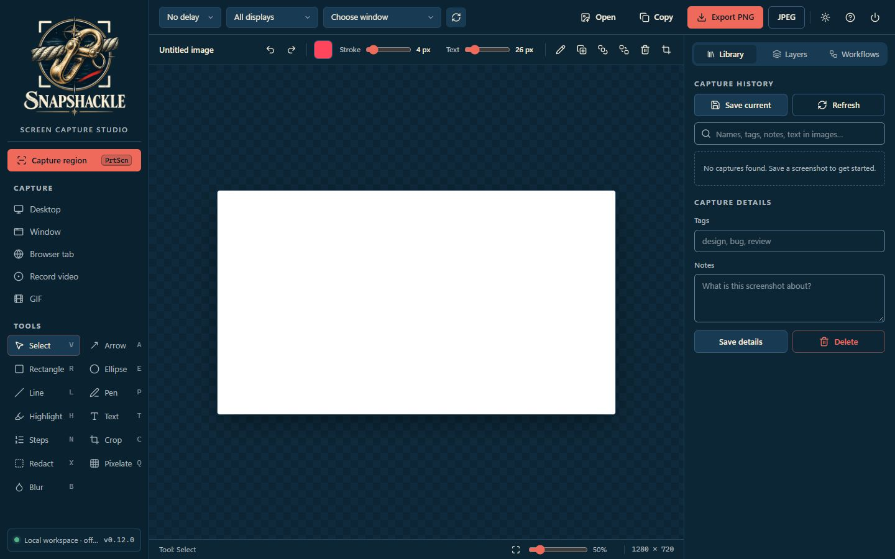
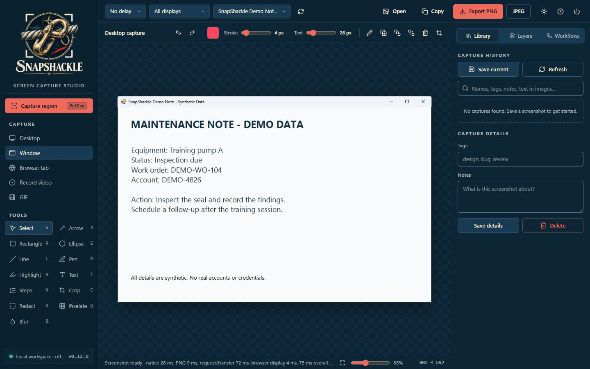
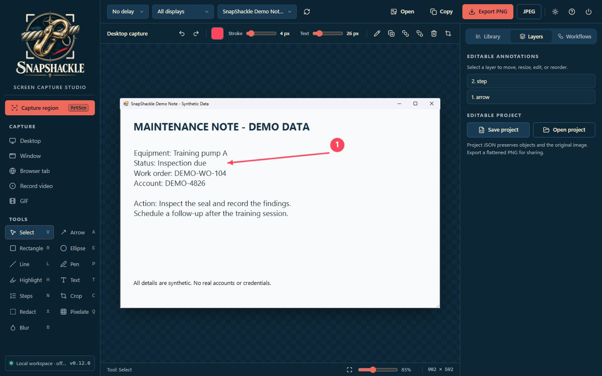
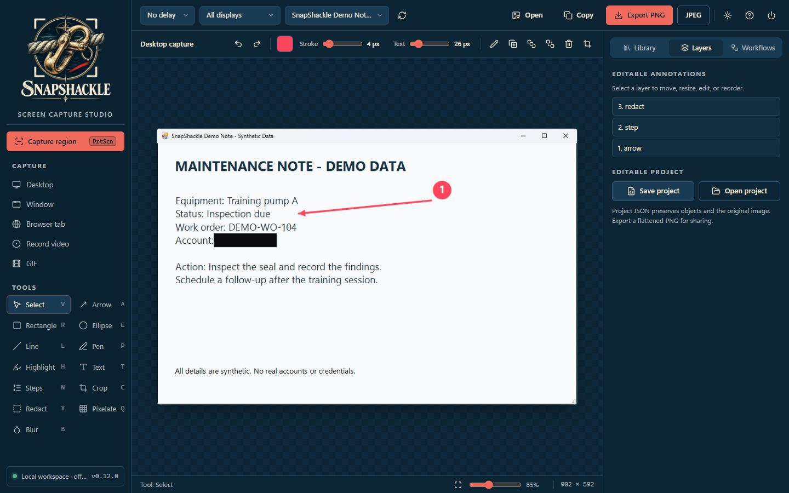
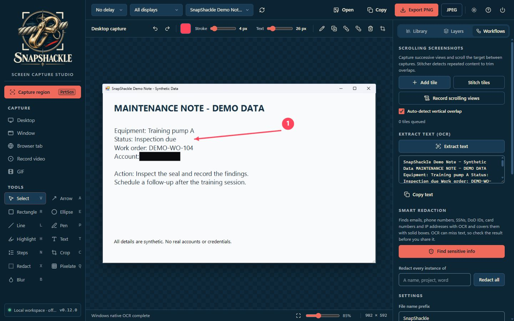
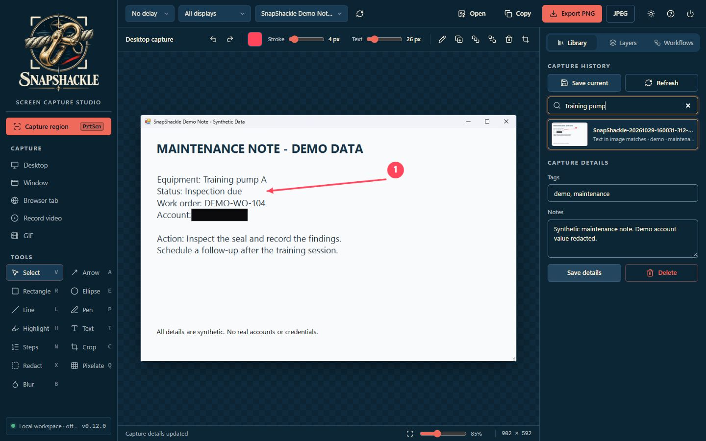
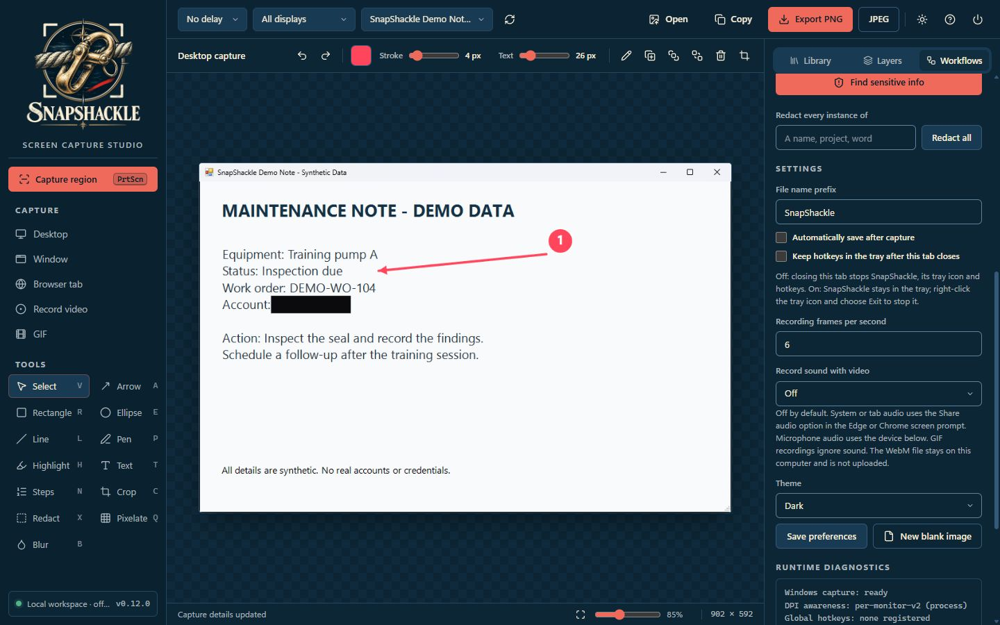

# SnapShackle walkthrough

Capture a window or region, annotate and redact it, read its text, and keep it in a searchable library.

> **Draft walkthrough.** The screenshots below have not been added yet. They must use demo data and be reviewed before publication. The image links will resolve when those screenshots are included.

## Before you start

- Windows PowerShell 5.1 (part of Windows). No administrator rights and no installer.
- Microsoft Edge or Google Chrome.
- Launch: Double-click `Launch-SnapShackle.bat` (opens the studio on `127.0.0.1`, port 8765 or the next free one).
- Closing the last studio tab normally stops the server, tray icon and hotkeys. See [Session lifecycle](../../README.md#session-lifecycle) for keeping hotkeys in the tray and ending a session.

## Steps

### 1. First launch

The studio opens with the capture toolbar and an empty **Library** tab.

### 2. Capture a window

Open **Capture**, choose **application window** and pick the window you want.

### 3. Annotate

Use the annotation tools to add arrows, shapes and text.

### 4. Redact

Cover anything sensitive with a redaction box before you share the image.

### 5. Read the text

**Extracted text** shows the text read from the capture, ready to copy.

### 6. Find it later

**Library** keeps your captures, searchable by their text.

### 7. Set hotkeys

**Workflows** holds the hotkeys and the option to keep them in the tray after the tab closes.

## About these images

Screenshots will be stored in [`docs/assets/walkthrough/`](../assets/walkthrough/), named `NN-<screen>.png` after their step. Capture them at 1440x900, 100% scale, in the Dark theme, using demo data only. Review them for sensitive content before adding them.
